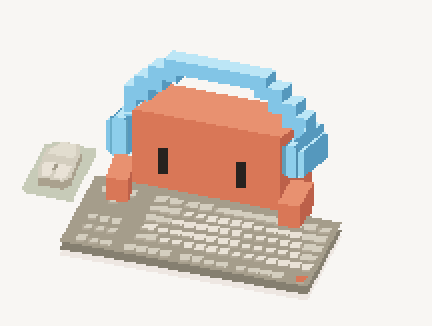

# Bongo Clawd

基于 bongo cat 灵感所构建的Clawd小桌宠，个人自娱自乐产物😽让Clawd来陪你码字吧！

Clawd获得一个桌面小工位！可以陪你敲键盘，移动鼠标和敲击键盘都有动作映射(尚未做到对多种型号键盘不同键位的适配orz)。忙起来会加速敲击，空闲时会左右张望、伸懒腰，再偷偷睡个小觉，目前有两种彩蛋动画。还可以换上耳机、猫耳、发芽或者头顶小黄鸭~未来会考虑加入更多装饰，给小蟹布置自己的小工位。

当前版本：**0.2.0-preview.5**，支持 **Windows 10 / 11 x64**。

## 先试试看

想先看看小蟹动起来？😺 [下载动画实验页（Clawd-lab.html）](https://github.com/miyomochi/bongo-clawd/raw/refs/heads/main/Clawd-lab.html)，保存后用浏览器打开就能玩，不用安装桌面程序。

实验页只响应网页内的操作，适合体验基础动画；更新可能比桌面版慢，完整功能以 Windows 桌面版为准。

## 下载与使用

1. 下载 [Windows x64 运行包](downloads/Bongo-Clawd-0.2.0-preview.5-Windows-x64.zip?raw=true)。
2. 完整解压，双击 `Bongo-Clawd.exe`。
3. 如果正在使用旧版，先从托盘菜单完全退出旧版，再启动新版。

！运行该程序需要系统已安装 Microsoft Edge WebView2 Runtime。若提示缺少运行时，可从 [微软官方页面](https://developer.microsoft.com/microsoft-edge/webview2/) 安装 Evergreen Runtime。

旧版可从 [v0.1.0 运行包](downloads/Bongo-Clawd-Lite-Windows-x64.zip?raw=true) 下载，旧版程序名为 `Bongo-Clawd-Lite.exe`。

## 版本说明及更新日志
0.2.0-增加了两种待机动画，增加头部装扮系统，优化了菜单等ui，调整了部分细节以更好适配，增加统计面板。
0.1.0-第一个可运行版本，包含桌宠的基本功能，敲字，使用鼠标，简单的菜单功能，快敲及睡眠动画。

## 小蟹会做什么

- **键鼠联动**：按键会点亮对应键位，小蟹跟着抬手、敲击；支持双手打字以及键鼠同时使用。
- **忙碌与休息**：持续快打时进入忙碌状态，放慢后Clawd也跟着缓口气；句子之间短暂停顿有缓冲，不会立即反复切换。
- **空闲小动作**：呼吸、左右张望、伸懒腰。默认空闲 90 秒后睡觉，可调整等待时间或关闭自动入睡。
- **惊醒装忙**：睡着后被键鼠叫醒，会心虚地赶紧敲一会，再继续工作。
- **待机状态可能触发**：戴墨镜、笑眯眯冒出想法泡，睡着时还会做梦。(触发频率不是很高，彩蛋性质)
- **头部装饰**：天蓝耳机、粉色猫耳耳机、树苗、小黄鸭，每件都有小动画。比较简单，请期待后续更新~
- **简短台词**：一般出现在状态变化时，会在头顶显示气泡；遇到动画自带的想法泡会先让位。可在设置中关闭。
- **可选敲击统计**：在键盘下方显示本次敲击次数，以及近 60 秒的平均敲击速率。

## 怎么操作

右侧三个方块，从上到下是 **设置、装饰、暂停**。按住Clawd或统计行可以拖动整个工位；右键Clawd本体或托盘图标也能打开菜单。

| 入口 | 功能 |
| --- | --- |
| 设置 | 调整大小、始终置顶、侧边按钮、台词、呼吸、入睡时间和统计 |
| 装饰 | 点选立即试穿；「戴上」保存，「取消」恢复原来的装扮 |
| 暂停 | 收起桌宠，显示「已暂停」小卡片；点一下继续，按住卡片可拖动 |
| 隐藏 | 收进托盘；隐藏期间仍保持键鼠联动与已开启的统计 |
| 显示小蟹 | 将隐藏的桌宠唤回；也可以双击托盘图标找回 |
| 退出 | 完全关闭程序，结束本次统计 |

打开设置或装饰菜单时，Clawd会暂时停工，调整期间的键鼠操作不会补播或计入统计。手动暂停的状态会保留。

装饰选中后立即播放试穿动画；确认后，等当前动画播完再说一句台词。换另一件或取消时，上一件待播放的台词会取消。已确认的装饰下次启动会恢复，但不会自动重播动画。

侧边按钮可以在设置或右键菜单中隐藏；隐藏后仍可从右键和托盘菜单访问功能。

**当前菜单说明**：「显示小蟹」暂时同时出现在小蟹右键菜单和托盘菜单里。小蟹已经显示时，点它通常不会有明显变化；它不是显示/隐藏单独立绘的切换开关，是整个桌宠显示。
设置底部的「启动时打开」控制程序启动后是否直接显示小蟹，不是 Windows 开机自启动。

## 敲击统计与隐私

统计默认关闭。开启后显示 **本次敲击次数** 和 **近 60 秒次数/分**；速率包含空闲时间，开启不足一分钟也不会按短时速度外推。

- 只累计实际键盘按下，包括修饰键；长按自动连发只计一次。
- 鼠标操作、动画中的模拟敲击不计入。
- 暂停、打开调整菜单或锁屏时不累计；隐藏到托盘仍累计。
- 次数与速度仅保存在内存中，关闭统计或完全退出程序即清零，不跨次保存。

键鼠事件只用于本地动画与上述聚合计数。**不解析输入文字、不读取剪贴板、不保存按键历史、不上传输入。** 

设置会自动保存至 `%APPDATA%\com.miyo.bongo-clawd-lite\settings.json`，包含外观、装饰和功能开关；沿用旧 Lite 版的配置路径。

## 开发与版本

画面采用纯 SVG 像素风格，桌面程序使用 Tauri、Rust 与系统 WebView2。动画模块位于 `web/core/`，Windows 桌面功能位于 `src-tauri/src/`。

`Clawd-lab.html` 是可单独打开的基础动画实验页，只响应网页内的操作；桌面版功能以运行程序为准，可以进去简单看动画，有时候不会特意去更新这个(。)

- [构建与项目结构](docs/BUILD.md)
- [验证记录](VALIDATION.md)
- [版本记录](CHANGELOG.md)
- [资源占用的比较口径](COMPARISON.md)

## 致谢与许可

本项目为非官方同好作品，Clawd 角色及相关品牌属于各自权利人。小蟹这个萌！

原创代码许可见 [LICENSE-CODE.txt](LICENSE-CODE.txt)，第三方说明见 [THIRD-PARTY-NOTICES.md](THIRD-PARTY-NOTICES.md)。
